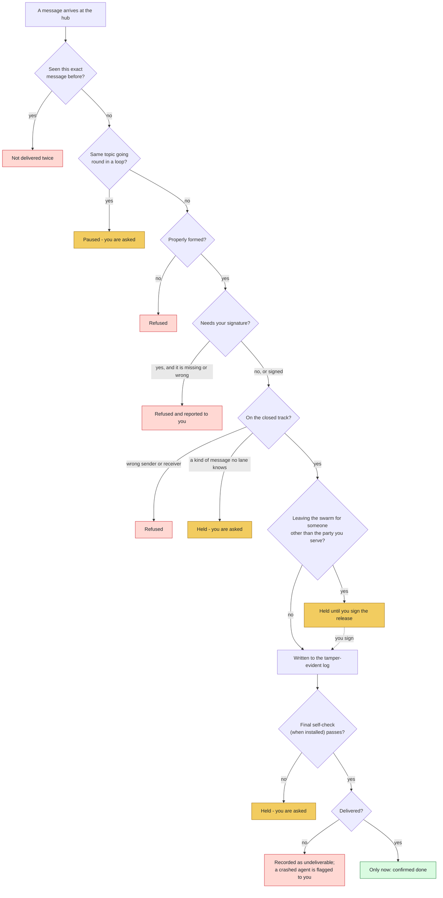

# Agent 00 - Dispatcher

The hub: it validates every message against the closed track, holds what it cannot route, and owns the audit log.

## What it does with every message

Every message between agents, to you, or to the outside world passes through the hub. These are its checks, in the order `dispatcher/hub.py` runs them. Yellow: waits for you. Red: stopped. Green: done.

## The rules it follows

- [SKILL.md](SKILL.md) - its job, its limits, and when it stops and asks you
- [DECISIONS.md](DECISIONS.md) - the decisions made ahead of time for it

*Generated by `tools/gen_diagrams.py`; edit the data or the generator, not this file.*
