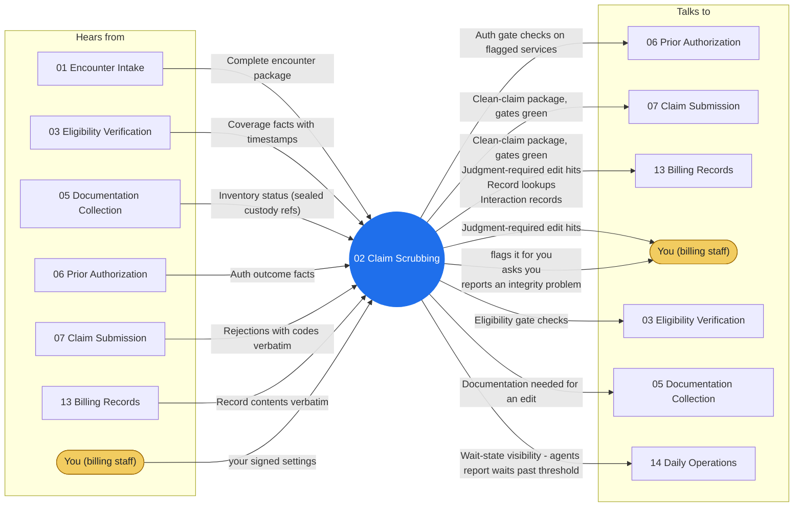

# Agent 02 - Claim Scrubbing

Runs encounters through the edit tables before submission: format edits, payer-specific requirements, modifier presence rules, frequency limits, NCCI pairs AS TABLE FACTS. THE LINE: a rule-table hit that can be fixed mechanically (missing field from the record) is fixed with the source cited; a hit that requires judgment (which modifier, whether codes conflict clinically) is a `scrub.exception` to the certified human - always.

## Who it works with

Left: who sends this agent messages. Right: who it sends messages to. The blue circle is the agent; the yellow box is you. Every arrow is a lane on the closed track (`identity/routes.json`); the hub refuses any message that is not on one.

## Playbooks it works in

- [P01 Charge to Clean Claim](../playbooks/P01-charge-to-clean-claim/README.md)
- [P11 Eligibility Change Mid-Cycle](../playbooks/P11-eligibility-change-midcycle/README.md)
- [P12 Secondary Claim Cascade](../playbooks/P12-secondary-claim-cascade/README.md)

## The rules it follows

- [SKILL.md](SKILL.md) - its job, its limits, and when it stops and asks you
- [DECISIONS.md](DECISIONS.md) - the decisions made ahead of time for it

*Generated by `tools/gen_diagrams.py`; edit the data or the generator, not this file.*
