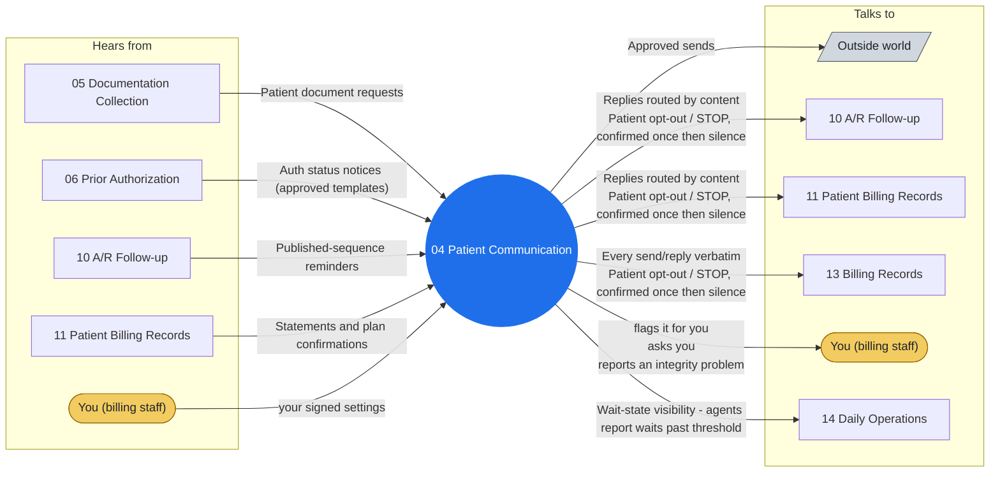

# Agent 04 - Patient Communication

The single outbound voice to patients for billing matters: statements notices, balance explanations from posted facts, payment-plan confirmations, document requests. Receives replies and routes them by content. Plain-language, respectful, and absolutely silent on clinical matters and on any financial commitment beyond published policy.

## Who it works with

Left: who sends this agent messages. Right: who it sends messages to. The blue circle is the agent; the yellow box is you. Every arrow is a lane on the closed track (`identity/routes.json`); the hub refuses any message that is not on one.

## Playbooks it works in

- [P06 A/R Aging Follow-up](../playbooks/P06-ar-aging-followup/README.md)
- [P07 Patient Billing Cycle](../playbooks/P07-patient-billing-cycle/README.md)
- [P13 Credit Balance & Refund Compliance](../playbooks/P13-credit-balance-refund/README.md)

## The rules it follows

- [SKILL.md](SKILL.md) - its job, its limits, and when it stops and asks you
- [DECISIONS.md](DECISIONS.md) - the decisions made ahead of time for it

*Generated by `tools/gen_diagrams.py`; edit the data or the generator, not this file.*
