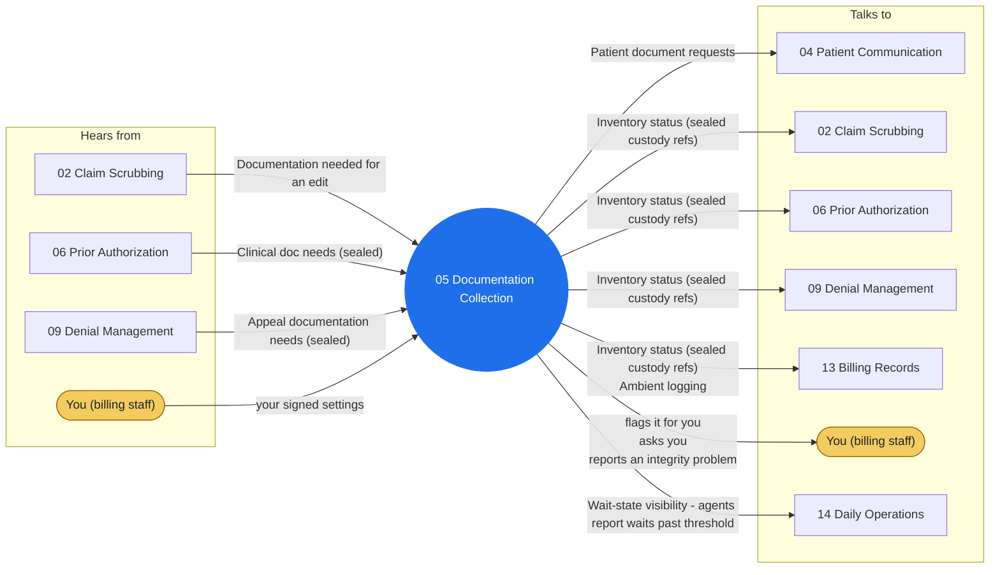

# Agent 05 - Documentation Collection

Owns the documentation pipeline for claims, auths, and appeals: operative notes, progress notes, orders, imaging reports, medical-necessity documentation. THE CUSTODY LINE: clinical documents are sealed transport - inventoried by existence, type, date, and source, routed to their destination (payer package, human coder), never opened for content by any swarm agent (HIPAA minimum necessary).

## Who it works with

Left: who sends this agent messages. Right: who it sends messages to. The blue circle is the agent; the yellow box is you. Every arrow is a lane on the closed track (`identity/routes.json`); the hub refuses any message that is not on one.

## Playbooks it works in

- [P01 Charge to Clean Claim](../playbooks/P01-charge-to-clean-claim/README.md)
- [P02 Prior Authorization Cycle](../playbooks/P02-prior-auth-cycle/README.md)
- [P05 Denial & Appeal Cycle](../playbooks/P05-denial-appeal-cycle/README.md)
- [P14 Records Request Response](../playbooks/P14-records-request-response/README.md)

## The rules it follows

- [SKILL.md](SKILL.md) - its job, its limits, and when it stops and asks you
- [DECISIONS.md](DECISIONS.md) - the decisions made ahead of time for it

*Generated by `tools/gen_diagrams.py`; edit the data or the generator, not this file.*
