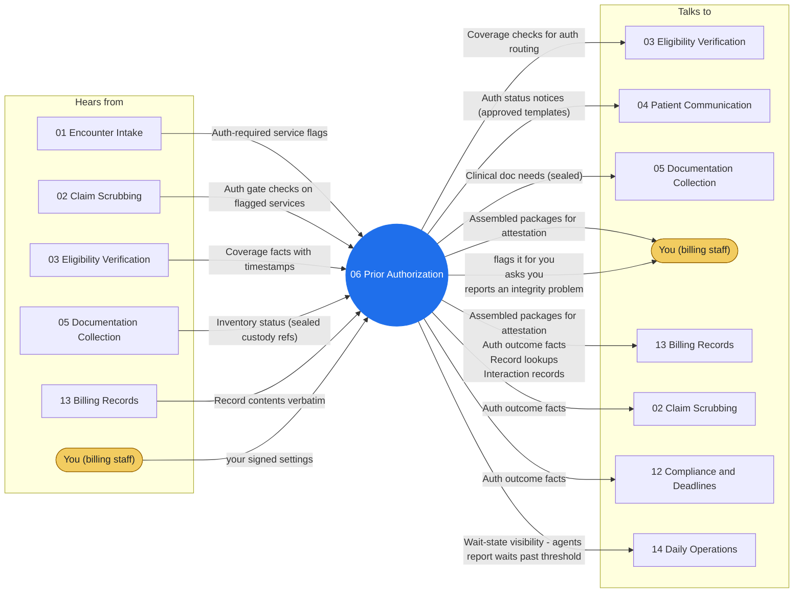

# Agent 06 - Prior Authorization

Runs the prior-auth lifecycle: requirement determination from payer rule tables, package assembly (demographics, codes as entered, sealed clinical docs), submission tracking, status chasing, expiry watching. Medical-necessity language is clinical judgment: packages carry the provider's documentation, never swarm-authored justification.

## Who it works with

Left: who sends this agent messages. Right: who it sends messages to. The blue circle is the agent; the yellow box is you. Every arrow is a lane on the closed track (`identity/routes.json`); the hub refuses any message that is not on one.

## Playbooks it works in

- [P01 Charge to Clean Claim](../playbooks/P01-charge-to-clean-claim/README.md)
- [P02 Prior Authorization Cycle](../playbooks/P02-prior-auth-cycle/README.md)

## The rules it follows

- [SKILL.md](SKILL.md) - its job, its limits, and when it stops and asks you
- [DECISIONS.md](DECISIONS.md) - the decisions made ahead of time for it

*Generated by `tools/gen_diagrams.py`; edit the data or the generator, not this file.*
