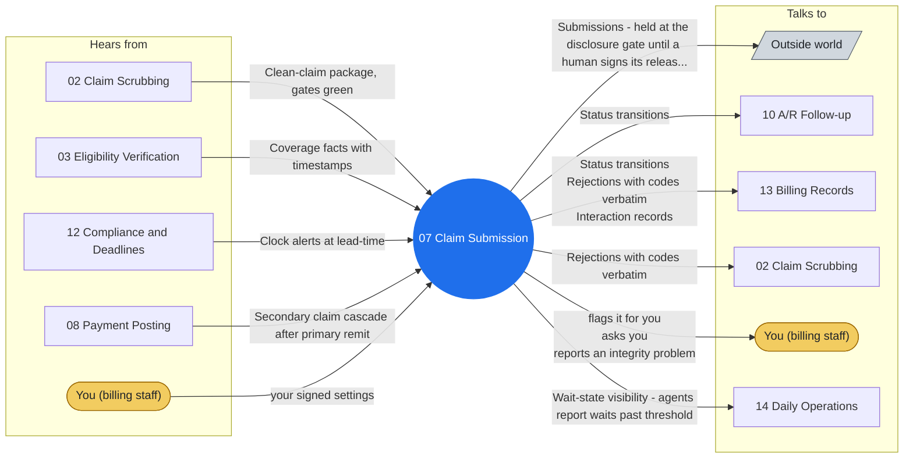

# Agent 07 - Claim Submission

Submits gate-green claims to clearinghouses and payers, confirms acceptance at both hops (clearinghouse accept AND payer accept - the clearinghouse accept alone is not submission), handles rejections back to scrubbing, and reports claim status. Verification means checking the acceptance artifact, not the send log.

## Who it works with

Left: who sends this agent messages. Right: who it sends messages to. The blue circle is the agent; the yellow box is you. Every arrow is a lane on the closed track (`identity/routes.json`); the hub refuses any message that is not on one.

## Playbooks it works in

- [P03 Claim Submission Cycle](../playbooks/P03-claim-submission-cycle/README.md)
- [P08 Timely Filing Protection](../playbooks/P08-timely-filing-protection/README.md)
- [P11 Eligibility Change Mid-Cycle](../playbooks/P11-eligibility-change-midcycle/README.md)
- [P12 Secondary Claim Cascade](../playbooks/P12-secondary-claim-cascade/README.md)

## The rules it follows

- [SKILL.md](SKILL.md) - its job, its limits, and when it stops and asks you
- [DECISIONS.md](DECISIONS.md) - the decisions made ahead of time for it

*Generated by `tools/gen_diagrams.py`; edit the data or the generator, not this file.*
