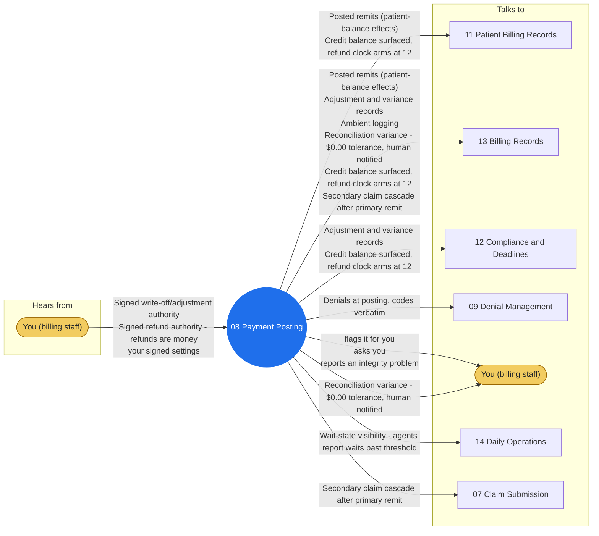

# Agent 08 - Payment Posting

Posts remittances exactly as the payer stated them: payments, contractual adjustments per the loaded contract rules, patient-responsibility amounts, denial codes. Contract-rule adjustments cite their rule; everything beyond (courtesy write-offs, small-balance adjustments outside policy, bad-debt) moves only on signed human authority. Denials route to 09 the moment they post.

## Who it works with

Left: who sends this agent messages. Right: who it sends messages to. The blue circle is the agent; the yellow box is you. Every arrow is a lane on the closed track (`identity/routes.json`); the hub refuses any message that is not on one.

## Playbooks it works in

- [P04 Payment Posting & Reconciliation](../playbooks/P04-payment-posting-reconciliation/README.md)
- [P12 Secondary Claim Cascade](../playbooks/P12-secondary-claim-cascade/README.md)
- [P13 Credit Balance & Refund Compliance](../playbooks/P13-credit-balance-refund/README.md)

## The rules it follows

- [SKILL.md](SKILL.md) - its job, its limits, and when it stops and asks you
- [DECISIONS.md](DECISIONS.md) - the decisions made ahead of time for it

*Generated by `tools/gen_diagrams.py`; edit the data or the generator, not this file.*
