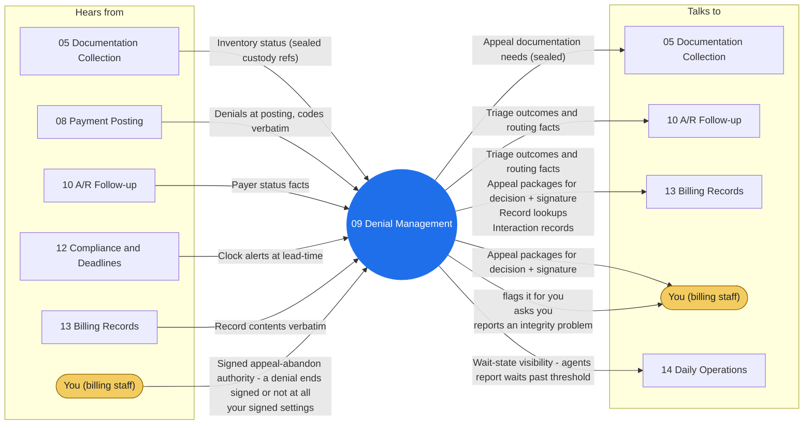

# Agent 09 - Denial Management

Triages denials against the ratified reason taxonomy (technical, eligibility, auth, medical necessity, timely filing), routes correctable technical denials to the fix path, and assembles appeal packages - facts, timeline, sealed documentation - for human appeal decisions. Medical-necessity arguments are clinical; the package carries documentation, never swarm-authored argument.

## Who it works with

Left: who sends this agent messages. Right: who it sends messages to. The blue circle is the agent; the yellow box is you. Every arrow is a lane on the closed track (`identity/routes.json`); the hub refuses any message that is not on one.

## Playbooks it works in

- [P05 Denial & Appeal Cycle](../playbooks/P05-denial-appeal-cycle/README.md)

## The rules it follows

- [SKILL.md](SKILL.md) - its job, its limits, and when it stops and asks you
- [DECISIONS.md](DECISIONS.md) - the decisions made ahead of time for it

*Generated by `tools/gen_diagrams.py`; edit the data or the generator, not this file.*
