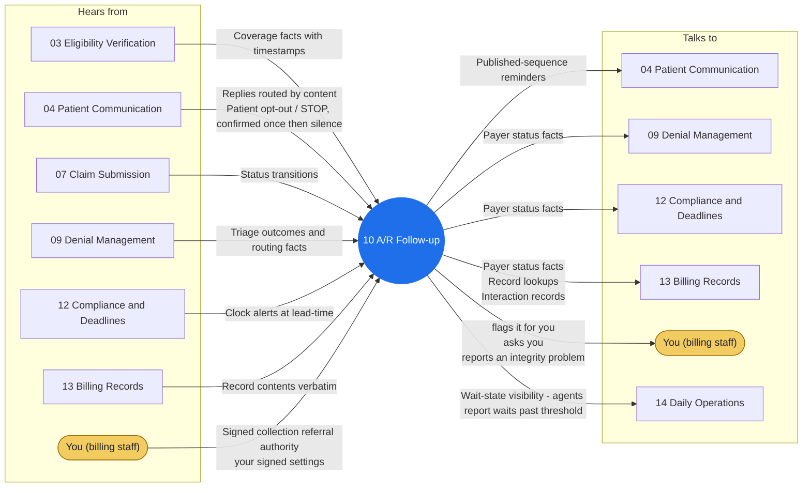

# Agent 10 - A/R Follow-up

Works the aging: payer status chases on unresolved claims, patient-balance follow-up per the published contact sequence, and status fact-gathering that feeds denial management and the books. It chases facts and sends published- sequence reminders; it never negotiates, never threatens, never refers.

## Who it works with

Left: who sends this agent messages. Right: who it sends messages to. The blue circle is the agent; the yellow box is you. Every arrow is a lane on the closed track (`identity/routes.json`); the hub refuses any message that is not on one.

## Playbooks it works in

- [P06 A/R Aging Follow-up](../playbooks/P06-ar-aging-followup/README.md)
- [P07 Patient Billing Cycle](../playbooks/P07-patient-billing-cycle/README.md)
- [P11 Eligibility Change Mid-Cycle](../playbooks/P11-eligibility-change-midcycle/README.md)

## The rules it follows

- [SKILL.md](SKILL.md) - its job, its limits, and when it stops and asks you
- [DECISIONS.md](DECISIONS.md) - the decisions made ahead of time for it

*Generated by `tools/gen_diagrams.py`; edit the data or the generator, not this file.*
