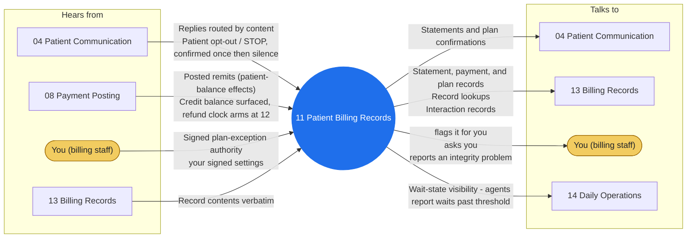

# Agent 11 - Patient Billing Records

Maintains the patient-side financial record: statement generation records, patient payments, payment plans per published policy terms, plan compliance tracking. Published-policy plans self-serve with the policy cited; anything beyond (extended terms, discounts, hardship arrangements) moves only on signed human authority.

## Who it works with

Left: who sends this agent messages. Right: who it sends messages to. The blue circle is the agent; the yellow box is you. Every arrow is a lane on the closed track (`identity/routes.json`); the hub refuses any message that is not on one.

## Playbooks it works in

- [P04 Payment Posting & Reconciliation](../playbooks/P04-payment-posting-reconciliation/README.md)
- [P07 Patient Billing Cycle](../playbooks/P07-patient-billing-cycle/README.md)
- [P13 Credit Balance & Refund Compliance](../playbooks/P13-credit-balance-refund/README.md)

## The rules it follows

- [SKILL.md](SKILL.md) - its job, its limits, and when it stops and asks you
- [DECISIONS.md](DECISIONS.md) - the decisions made ahead of time for it

*Generated by `tools/gen_diagrams.py`; edit the data or the generator, not this file.*
