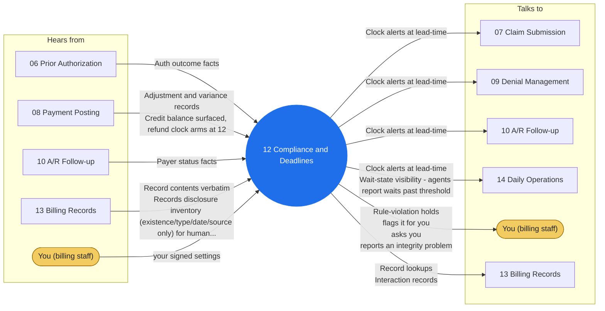

# Agent 12 - Compliance & Deadlines

Runs the clock engine: timely-filing limits per payer, appeal deadlines per denial, auth validity windows, records-request response clocks. Maintains the payer rule table per owner-ratified updates. A missed clock is never silent - escalation fires at the ratified lead-time, before the miss.

## Who it works with

Left: who sends this agent messages. Right: who it sends messages to. The blue circle is the agent; the yellow box is you. Every arrow is a lane on the closed track (`identity/routes.json`); the hub refuses any message that is not on one.

## Playbooks it works in

- [P02 Prior Authorization Cycle](../playbooks/P02-prior-auth-cycle/README.md)
- [P05 Denial & Appeal Cycle](../playbooks/P05-denial-appeal-cycle/README.md)
- [P08 Timely Filing Protection](../playbooks/P08-timely-filing-protection/README.md)
- [P13 Credit Balance & Refund Compliance](../playbooks/P13-credit-balance-refund/README.md)
- [P14 Records Request Response](../playbooks/P14-records-request-response/README.md)

## The rules it follows

- [SKILL.md](SKILL.md) - its job, its limits, and when it stops and asks you
- [DECISIONS.md](DECISIONS.md) - the decisions made ahead of time for it

*Generated by `tools/gen_diagrams.py`; edit the data or the generator, not this file.*
