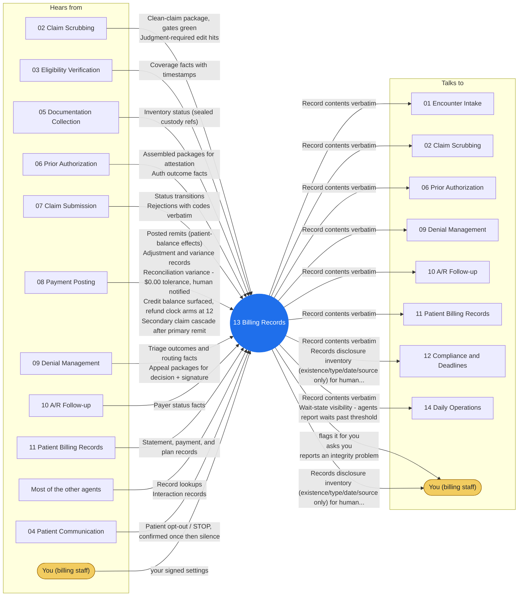

# Agent 13 - Billing Records

The billing file: every claim's lifecycle record, the append-only audit trail, record lookups, retention rules. Clinical documents live as sealed custody references (05's flags); billing facts are minimum-necessary scoped. A record request is answered from the record, never from inference.

## Who it works with

Left: who sends this agent messages. Right: who it sends messages to. The blue circle is the agent; the yellow box is you. Every arrow is a lane on the closed track (`identity/routes.json`); the hub refuses any message that is not on one.

## Playbooks it works in

- [P11 Eligibility Change Mid-Cycle](../playbooks/P11-eligibility-change-midcycle/README.md)
- [P14 Records Request Response](../playbooks/P14-records-request-response/README.md)

## The rules it follows

- [SKILL.md](SKILL.md) - its job, its limits, and when it stops and asks you
- [DECISIONS.md](DECISIONS.md) - the decisions made ahead of time for it

*Generated by `tools/gen_diagrams.py`; edit the data or the generator, not this file.*
