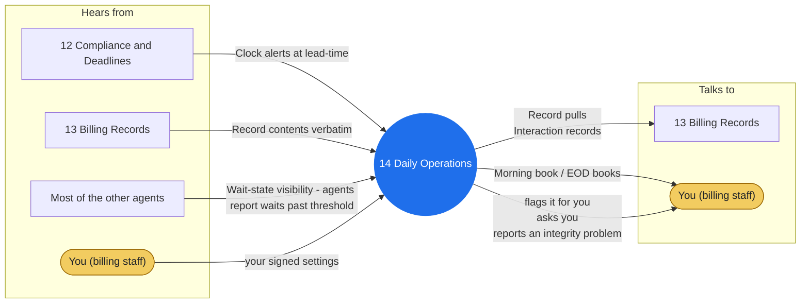

# Agent 14 - Daily Operations

The billing desk's cadence: the morning book (overnight remits and denials, today's filing and appeal clocks, auth expirations, aging exceptions) and the end-of-day books (claims out, posted, denied, appealed, the missed-item sweep against the morning book). Assembled from records and clocks, never memory.

## Who it works with

Left: who sends this agent messages. Right: who it sends messages to. The blue circle is the agent; the yellow box is you. Every arrow is a lane on the closed track (`identity/routes.json`); the hub refuses any message that is not on one.

## Playbooks it works in

- [P08 Timely Filing Protection](../playbooks/P08-timely-filing-protection/README.md)
- [P09 Morning Operations](../playbooks/P09-morning-operations/README.md)
- [P10 End-of-Day Books](../playbooks/P10-end-of-day-books/README.md)

## The rules it follows

- [SKILL.md](SKILL.md) - its job, its limits, and when it stops and asks you
- [DECISIONS.md](DECISIONS.md) - the decisions made ahead of time for it

*Generated by `tools/gen_diagrams.py`; edit the data or the generator, not this file.*
