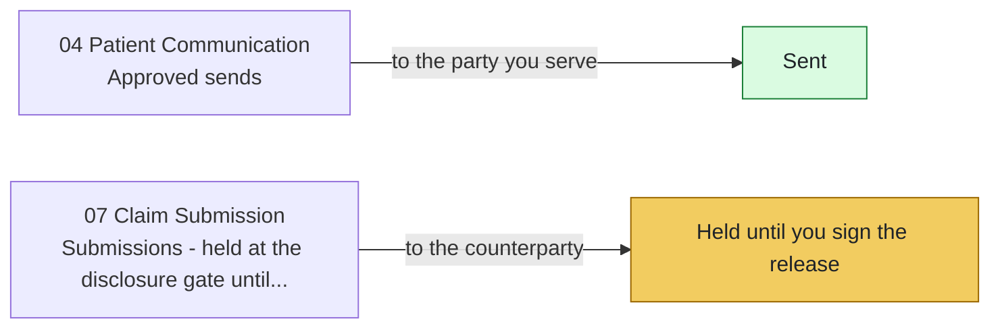

# medbilling-agents - medical billing vertical for the DispatcherAgents runtime

An **identity side-load**: everything vertical-specific for a 15-agent
medical-billing (revenue cycle) swarm, loadable into the content-neutral
[dispatcher-agents](https://github.com/QuietFireAI/dispatcher-agents) runtime.
The runtime never contains vertical text, and this repo never edits transport
code: `dispatcher/` holds a byte-identical copy of the dispatcher-agents core,
checked by `tools/sync_core.py --check`. That split is the architecture.

**Status: v0.2 ratified 2026-07-18 (extended from v0.1 2026-07-11) - owner sign-off. WORKING BUILD: vendored dispatcher core + real spokes, 43-test suite (`tests_medbilling/`: playbooks end to end, the core boot test, MCP signing, diagrams), live demo (`tools/run_demo.py`), and an MCP mount (`docs/MOUNTING.md`). No licensed legal, compliance (HIPAA), or coding-practice review has been performed.**

## What this is for

```mermaid
flowchart LR
    B(["You (billing staff)"])
    H{{"00 Dispatcher hub<br/>carries and logs every message"}}
    B -- "signed decisions and settings" --> H
    H -- "questions, holds, reports" --> B
    subgraph AG["The agents - each owns one job"]
        direction TB
        A01["01 Encounter Intake"]
        A02["02 Claim Scrubbing"]
        A03["03 Eligibility Verification"]
        A04["04 Patient Communication"]
        A05["05 Documentation Collection"]
        A06["06 Prior Authorization"]
        A07["07 Claim Submission"]
        A08["08 Payment Posting"]
        A09["09 Denial Management"]
        A10["10 A/R Follow-up"]
        A11["11 Patient Billing Records"]
        A12["12 Compliance and Deadlines"]
        A13["13 Billing Records"]
        A14["14 Daily Operations"]
    end
    H <--> AG
    X[/"Outside world"/]
    H <-- "only on open lanes; anyone but the party you serve waits for your release" --> X
    classDef you fill:#f2cc60,stroke:#9a6700,color:#1f2328
    classDef hub fill:#1f6feb,stroke:#1f6feb,color:#ffffff
    classDef out fill:#d0d7de,stroke:#57606a,color:#1f2328
    class B you
    class H hub
    class X out
```

<!-- diagram:readme-what-this-is-for - drawn by tools/gen_diagrams.py; edit the generator, not here -->


*Every arrow goes through the hub, and only on lanes in `identity/routes.json`. Each agent's own picture is in its folder; each playbook's in `playbooks/`.*
<!-- /diagram:readme-what-this-is-for -->

Operations support for a billing desk or billing service: charge capture with
codes as provider-entered, edit-table scrubbing with certified-human exits,
eligibility facts with timestamps, prior-auth packages for clinical
attestation, dual-artifact submission confirmation, verbatim remit posting
with contract-rule citations, deadline-tracked denial and appeal packages,
published-sequence A/R follow-up, policy-cited patient billing, the filing
clock engine, an append-only billing file, and the daily books.

What it never does - the five absolute lines (identity/IDENTITY-medical-billing-agent.md):

1. The swarm never codes - judgment exits to the certified human coder.
2. Clinical content is sealed custody (HIPAA) - moved, never read; medical
   necessity is never swarm-authored.
3. No unsigned money - write-offs and plan exceptions move only on signed
   authority.
4. No pressure beyond the published contact sequence - hardship and
   settlements are human decisions.
5. A denial never dies quietly, a clock never slips silently.

## Layout

| Path | What it is |
|---|---|
| `identity/routes.json` | The closed track: 44 (intent, senders, receivers) routes, outbound routes labelled with their audience - single source of truth |
| `dispatcher/` | The dispatcher-agents core, vendored: the 16 files listed in `tools/sync_core.py`, byte-identical to core and never edited here; this identity's own runtime (`medbilling_spokes.py`, `identity_mcp.py`, `sweep_runner.py`) sits beside them and the sync never touches it |
| `tools/sync_core.py` | Copies the core in (`--core <path>`) or checks it (`--check`: exit 1 on any drift) |
| `tests_medbilling/test_core_boot.py` | This identity loaded into the core: loader, audience labels, principal delivery, counterparty hold and signed release, authority signatures, closed track |
| `requirements.txt` | pytest, cryptography, the six pillars pinned to the commits the suite passed against, and the MCP package |
| `.github/workflows/ci.yml` | CI on every push: install and test, core parity against dispatcher-agents main, and the suite with no pillars installed |
| `tools/gen_diagrams.py` | Draws the pictures: each agent folder's and each playbook folder's README.md, `playbooks/README.md`, and the diagrams on this README and the other pages, including real playbook runs in `docs/PLAY-BY-PLAY.md`; `--check` (and a test) fails when one is stale; run it after `gen_docs.py`, which rewrites some of those pages |
| `identity/priority.json` | JIT playbook priority classes (ratified 2026-07-11; extended & ratified 2026-07-18) |
| `identity/IDENTITY-medical-billing-agent.md` | The identity declaration |
| `00-dispatcher/ ... 14-daily-operations/` | 15 agent SKILL.md + DECISIONS.md (tuple layer) |
| `playbooks/P01 ... P14` | Deployment playbooks: charge-to-clean-claim through records requests |
| `SWARM.md` | Framework manifest + swarm-level tuples |
| `MANNERS.md` | Conduct constants, hash-registered at boot attestation |
| `TUPLE_INDEX.md` | Generated drill-down: tuple → agent → playbooks |
| `generate_skills.py` / `gen_meta.py` / `gen_playbooks.py` / `gen_tuple_index.py` | Generators - data tables are the spec; files are build artifacts |
| `verify_swarm.py` | Enforcement: tuple legality, edge completeness, regression - exit 0 = clean |

## Outbound messages

<!-- diagram:readme-outbound-messages - drawn by tools/gen_diagrams.py; edit the generator, not here -->

<!-- /diagram:readme-outbound-messages -->

Every route that leaves the swarm names its audience in `identity/routes.json`
(owner decision, 2026-10-12):

| Route | Sender | Audience | On send |
|---|---|---|---|
| `patient.message.send` | 04 | principal | delivered on the ack |
| `claim.submit` | 07 | counterparty | held until a human signs its release |

The principal is the party this identity serves. A counterparty message is
held in `clarification.request` before it is persisted or delivered (the hold
itself is on the audit log), and goes out only when a human signs a
`disclosure.authority` naming that exact message (`Hub.release_disclosure`).
It goes out once; an unsigned or repeated release sends nothing. A route left
without a label is treated as counterparty.

## Verify

```bash
pip install -r requirements.txt
python3 verify_swarm.py    # 0 failures, 0 warnings expected
python -m pytest tests_medbilling/    # 43 passed
python tools/sync_core.py --core ../dispatcher-agents --check   # 16 files, zero drift
```

## Load into the runtime

```bash
git clone https://github.com/QuietFireAI/dispatcher-agents.git
git clone https://github.com/QuietFireAI/medbilling-agents.git
cd dispatcher-agents && pip install -e ".[pillars,crypto,dev]"
```

```python
from dispatcher.loader import load_identity
ident = load_identity("/path/to/medbilling-agents")
```

The loader is fail-closed: no routes.json, no track, no load. It audits the
priority table's status on every load - never silently.

## Sibling identities

- [listing-assistants](https://github.com/QuietFireAI/listing-assistants) (formerly listing-agents) - real-estate listing vertical (ratified)
- [claim-agents](https://github.com/QuietFireAI/claim-agents) - insurance claims vertical (ratified)
- [reservation-agents](https://github.com/QuietFireAI/reservation-agents) - park/resort reservations vertical (ratified)
- mortgage-agents, property-mgmt-agents, practice-agents - this drop's siblings

## License

Dual-licensed under the **QuietFire Identity License** (see `LICENSE`) over
an **AGPL-3.0** floor (see `LICENSE-AGPL`). Evaluation, development, and
internal testing — including cloning, running the suite, and any demo — are
free. **Production and commercial use require a paid license from
QuietFireAI or full AGPL-3.0 compliance.** Building derivative identities
for third parties is not permitted without a commercial license. The
supported commercial operating environment is TelsonBase. The open chassis
this runs on (dispatcher-agents) is Apache-2.0 and separate. The vendored copy in
`dispatcher/` keeps that license (`dispatcher/LICENSE-CORE`).

*License text is a placeholder pending counsel review.*

## See it work (2 minutes)

```
pip install -r requirements.txt
python3 tools/run_demo.py            # one patient, six acts, real hub
python -m pytest tests_medbilling/   # every playbook P01-P14, every gate
```

The demo runs a real encounter to a gate-green claim, submission with
both acceptance artifacts, a remit with a one-cent variance (caught), a
medical-necessity denial (routed to the human, never argued), a credit
balance with the 60-day clock armed, an UNSIGNED refund (rejected by the
hub) then a signed one (executed), a patient STOP (sequence dead same
turn), and finishes by verifying the hash chain. docs/START_HERE.md is
the 60-second tour; docs/OPERATOR_TESTING_MANUAL.md is the filmable
script including the adversarial tests.

