# DispatcherAgents Medical Billing Swarm (Healthcare RCM) - Roster v0.2 (ratified 2026-07-18 - owner sign-off)

```mermaid
flowchart LR
    B(["You (billing staff)"])
    H{{"00 Dispatcher hub<br/>carries and logs every message"}}
    B -- "signed decisions and settings" --> H
    H -- "questions, holds, reports" --> B
    subgraph AG["The agents - each owns one job"]
        direction TB
        A01["01 Encounter Intake"]
        A02["02 Claim Scrubbing"]
        A03["03 Eligibility Verification"]
        A04["04 Patient Communication"]
        A05["05 Documentation Collection"]
        A06["06 Prior Authorization"]
        A07["07 Claim Submission"]
        A08["08 Payment Posting"]
        A09["09 Denial Management"]
        A10["10 A/R Follow-up"]
        A11["11 Patient Billing Records"]
        A12["12 Compliance and Deadlines"]
        A13["13 Billing Records"]
        A14["14 Daily Operations"]
    end
    H <--> AG
    X[/"Outside world"/]
    H <-- "only on open lanes; anyone but the party you serve waits for your release" --> X
    classDef you fill:#f2cc60,stroke:#9a6700,color:#1f2328
    classDef hub fill:#1f6feb,stroke:#1f6feb,color:#ffffff
    classDef out fill:#d0d7de,stroke:#57606a,color:#1f2328
    class B you
    class H hub
    class X out
```

<!-- diagram:roster-roster - drawn by tools/gen_diagrams.py; edit the generator, not here -->

*Every arrow goes through the hub, and only on lanes in `identity/routes.json`. Each agent's own picture is in its folder; each playbook's in `playbooks/`.*
<!-- /diagram:roster-roster -->

15 agents, hub-and-spoke via 00. All inter-agent communication is a logged
envelope through the Dispatcher; the route-space is closed (identity/routes.json).

| # | Agent | Type | Autonomy boundary |
|---|---|---|---|
| 00 | Dispatcher | Hub (transport, gates, audit) | Validates every (from, intent, to) tuple; holds ambiguity; owns the audit log |
| 01 | Encounter Intake Agent | Intake (charge capture) | Autonomous charge-capture intake and completeness checks; NEVER assigns or changes a code - coding judgment is certified-human territory |
| 02 | Claim Scrubbing Agent | Rules engine (claim edits) | Autonomous rule-table edits (format, completeness, payer-specific requirements); ANY edit requiring coding judgment routes to the certified human - the scrubber checks rules, it never practices coding |
| 03 | Eligibility Verification Agent | Systems lookup (coverage facts) | Autonomous eligibility and benefits lookups; reports payer-system facts with timestamps - never coverage promises, never patient-liability guarantees |
| 04 | Patient Communication Agent | Communication hub (patient-facing) | Autonomous sends from approved templates; NO clinical content, no collection pressure beyond the published sequence, no hardship decisions |
| 05 | Documentation Collection Agent | Evidence pipeline (clinical documentation custody) | Autonomous request, receipt, inventory, and chase per cadence; clinical CONTENT is sealed custody - the swarm inventories existence and routes, it never reads or summarizes clinical records |
| 06 | Prior Authorization Agent | Coordination (auth lifecycle) | Autonomous auth-requirement checks, package assembly, submission tracking, and status reporting; clinical attestations and peer-to-peer scheduling are human - the swarm never states medical necessity |
| 07 | Claim Submission Agent | Systems execution (clearinghouse) | Autonomous submission of gate-green claims and rejection handling; a claim submits once per scrub version - resubmission without a new scrub is the named duplicate-billing vector |
| 08 | Payment Posting Agent | Financial records (remits, adjustments) | Autonomous ERA/EOB posting per remit facts and contract-rule adjustments; ANY write-off or adjustment beyond contract rules executes only on signed human `writeoff.authority` |
| 09 | Denial Management Agent | Recovery preparation (denials, appeals) | Autonomous denial triage per the ratified reason taxonomy and appeal-package assembly; the appeal DECISION, clinical argument, and signature are human |
| 10 | A/R Follow-up Agent | Pipeline chase (accounts receivable) | Autonomous status chasing per the aging cadence and published patient-contact sequence; settlements, hardship, and collection-agency referrals are human decisions |
| 11 | Patient Billing Records Agent | Financial records (patient balances, plans) | Autonomous statement records and payment plans WITHIN published policy; plan exceptions, discounts, and hardship arrangements execute only on signed human `plan.authority` |
| 12 | Compliance & Deadlines Agent | Regulatory engine (filing clocks, payer rules) | Autonomous clock tracking and alerting; payer rule-table changes and any external response are human-ratified/signed |
| 13 | Billing Records Agent | System of record (billing file, audit) | Autonomous record keeping; the record is append-only - corrections are new entries referencing what they correct; clinical custody flags are absolute (HIPAA) |
| 14 | Daily Operations Agent | Operations cadence (books) | Autonomous book assembly and presentation; the human reads the book and directs - the book never self-executes its recommendations |

Human lanes (never automated): all coding judgment (certified coder), clinical statements and medical-necessity argument, appeal decisions and signatures, write-offs and adjustments beyond contract rules (signed authority), payment-plan exceptions and hardship arrangements, collection referrals, anything touching sealed clinical content (HIPAA custody), payer/regulator submissions.
