# Play-by-Play - What Actually Happens, Step by Step

Every playbook narrated as hub traffic: who moves, what envelope
carries it, and what proves the step happened. GENERATED from
medbilling_playbooks.py. The e2e suite
(tests_medbilling/test_playbooks_e2e_all.py) executes these exact
sequences against the real hub - this document describes what the
tests prove.

## P01 - Charge to Clean Claim

<!-- diagram:run-p01 - drawn by tools/gen_diagrams.py; edit the generator, not here -->
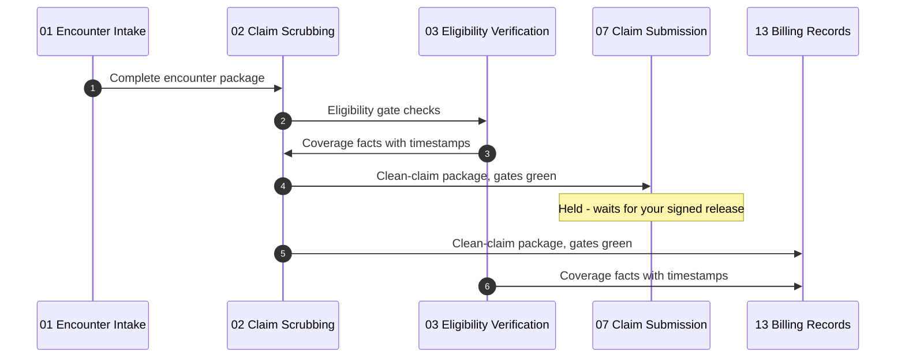

*One recorded run of `test_p01_charge_to_clean_claim`, numbered in order. Left out: each agent logging to the record and reporting what it is waiting on. The ratified steps: [playbooks/P01-charge-to-clean-claim](../playbooks/P01-charge-to-clean-claim/README.md).*
<!-- /diagram:run-p01 -->

*It starts when:* `encounter.captured` lands at 02 from the intake feed.

**Phase 1 - Gates (parallel)**

1. Agent 03: Verify eligibility on DOS from live payer systems.
   - Wire: `eligibility.result` → 02, 13
   - Proof it happened: coverage facts with payer-system timestamps
2. Agent 06: Confirm auth requirement per rule table; auth path fires if required.
   - Wire: `auth.status` → 02, 12, 13
   - Proof it happened: auth gate state on record with rule citation

**Phase 2 - Scrub**

3. Agent 02: Run edit tables; mechanical fixes cite sources; judgment hits exit.
   - Wire: `scrub.exception` → human, 13 (as needed)
   - Proof it happened: every hit carries its rule citation
4. Agent 05: Collect documentation an edit requires (sealed custody).
   - Wire: `doc.received` → 02, 13
   - Proof it happened: inventory current, content sealed
5. Agent 02: Release the gate-green package.
   - Wire: `scrub.result` → 07, 13
   - Proof it happened: package with edit-table version recorded

*It can stop early:*
- Eligibility unknown (payer system down): claim holds; the outage is named on the record.
- Judgment-required edit unresolved: claim holds at the exception; the human's resolution re-enters through a fresh scrub.

## P02 - Prior Authorization Cycle

<!-- diagram:run-p02 - drawn by tools/gen_diagrams.py; edit the generator, not here -->
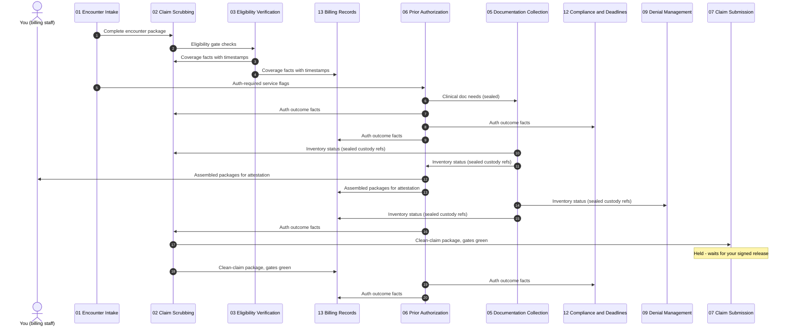

*One recorded run of `test_p02_prior_auth_cycle`, numbered in order. Left out: each agent logging to the record and reporting what it is waiting on. The ratified steps: [playbooks/P02-prior-auth-cycle](../playbooks/P02-prior-auth-cycle/README.md).*
<!-- /diagram:run-p02 -->

*It starts when:* `auth.request` at 06 from intake or scrubbing.

**Phase 1 - Package**

1. Agent 03: Coverage facts for auth routing.
   - Wire: `eligibility.result` → 06, 13
   - Proof it happened: payer and plan facts attached
2. Agent 05: Clinical documentation per the auth checklist (sealed).
   - Wire: `doc.received` → 06, 13
   - Proof it happened: custody references attached, content sealed
3. Agent 06: Assemble the package: demographics, provider-entered codes, sealed docs.
   - Wire: `auth.package` → human, 13
   - Proof it happened: package delivered for clinical attestation - the human signs and submits

**Phase 2 - Track**

4. Agent 06: Chase status per cadence; report outcome facts.
   - Wire: `auth.status` → 02, 12, 13
   - Proof it happened: auth number, valid dates, unit limits on record
5. Agent 06: Patient status notices on approved templates.
   - Wire: `patient.message.request` → 04
   - Proof it happened: sends logged
6. Agent 12: Validity window and expiry clocks armed.
   - Wire: (clock instantiation)
   - Proof it happened: expiry alerts at lead-time

*It can stop early:*
- Auth denied: facts to 02 and human; appeal consideration follows the denial path with a human decision.
- Pended past the service-date lead-time: escalation with the pend reason verbatim; the human decides the service-day call.

## P03 - Claim Submission Cycle

<!-- diagram:run-p03 - drawn by tools/gen_diagrams.py; edit the generator, not here -->
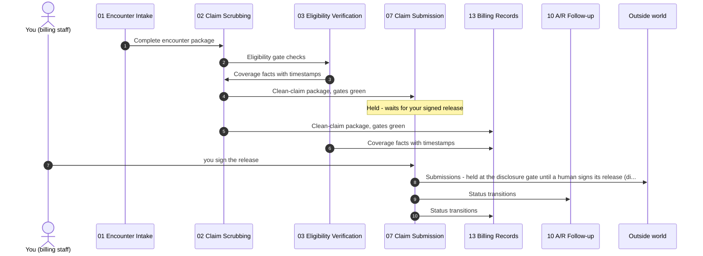

*One recorded run of `test_p03_submission_needs_both_artifacts`, numbered in order. Left out: each agent logging to the record and reporting what it is waiting on. The ratified steps: [playbooks/P03-claim-submission-cycle](../playbooks/P03-claim-submission-cycle/README.md).*
<!-- /diagram:run-p03 -->

*It starts when:* `scrub.result` at 07.

**Phase 1 - Submit and confirm**

1. Agent 07: Submit; capture the clearinghouse acceptance artifact.
   - Wire: `claim.submit` → external
   - Proof it happened: clearinghouse accept on record
2. Agent 07: Confirm payer acceptance; chase at lead-time if silent.
   - Wire: `claim.status` → 10, 13
   - Proof it happened: payer accept artifact on record - only now is it submitted

**Phase 2 - Rejections**

3. Agent 07: Route rejections with codes verbatim; no local fixes.
   - Wire: `rejection.notice` → 02, 13
   - Proof it happened: rejection re-enters through a fresh scrub

*It can stop early:*
- Payer acknowledgment absent past lead-time: claim is NOT submitted; escalation with the chase history.

## P04 - Payment Posting & Reconciliation

<!-- diagram:run-p04 - drawn by tools/gen_diagrams.py; edit the generator, not here -->
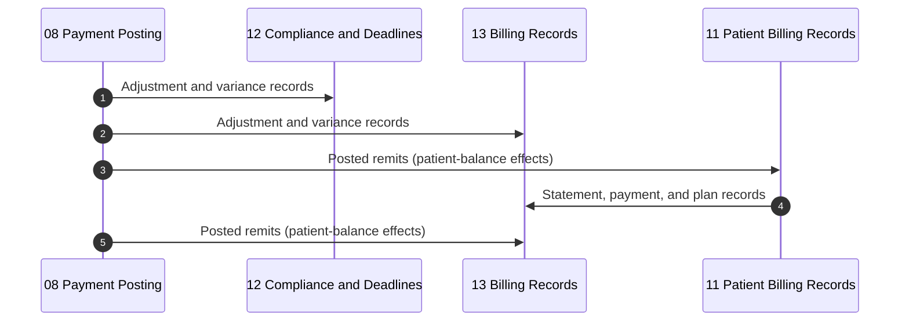

*One recorded run of `test_p04_posting_contract_rules_and_unruled_hold`, numbered in order. Left out: each agent logging to the record and reporting what it is waiting on. The ratified steps: [playbooks/P04-payment-posting-reconciliation](../playbooks/P04-payment-posting-reconciliation/README.md).*
<!-- /diagram:run-p04 -->

*It starts when:* ERA/EOB remittance arrives at 08.

**Phase 1 - Post**

1. Agent 08: Post payments, contractual adjustments (rule cited per line), patient responsibility.
   - Wire: `remit.posted` → 11, 13
   - Proof it happened: every line tied to claim + remit reference
2. Agent 08: Record variances against contract computation.
   - Wire: `adjustment.record` → 12, 13
   - Proof it happened: variance facts visible, never absorbed
3. Agent 08: Route denials at posting time, codes verbatim.
   - Wire: `denial.intake` → 09
   - Proof it happened: no denial sits in a posted pile

**Phase 2 - Patient-side effects**

4. Agent 11: Update patient balances; statement cycle picks up per policy.
   - Wire: `billing.record` → 13
   - Proof it happened: balance records current

*It can stop early:*
- Unruled adjustment code: payment posts, adjustment holds unapplied, human flagged.
- Authority anomaly (changed balance since signing): hold + re-confirm naming both states.

## P05 - Denial & Appeal Cycle

<!-- diagram:run-p05 - drawn by tools/gen_diagrams.py; edit the generator, not here -->
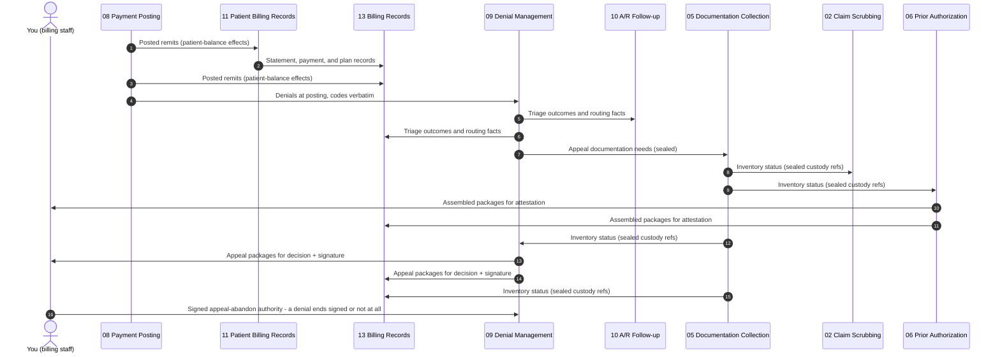

*One recorded run of `test_p05_denial_two_lane_and_signed_ending`, numbered in order. Left out: each agent logging to the record and reporting what it is waiting on. The ratified steps: [playbooks/P05-denial-appeal-cycle](../playbooks/P05-denial-appeal-cycle/README.md).*
<!-- /diagram:run-p05 -->

*It starts when:* `denial.intake` at 09.

**Phase 1 - Triage**

1. Agent 09: Triage per the ratified taxonomy; shorter-clock category wins ties.
   - Wire: `denial.triage` → 10, 13
   - Proof it happened: category + appeal deadline on record
2. Agent 12: Appeal clock armed with lead-time alerts.
   - Wire: `deadline.alert` → 09 (at lead-times)
   - Proof it happened: clock live

**Phase 2 - Package**

3. Agent 05: Appeal documentation per checklist (sealed custody).
   - Wire: `doc.received` → 09, 13
   - Proof it happened: custody references attached
4. Agent 09: Assemble the package: denial verbatim, claim history, sealed docs.
   - Wire: `appeal.package` → human, 13
   - Proof it happened: package delivered inside the lead-time for human decision + signature

*It can stop early:*
- Deadline certain to be missed: escalation with the miss quantified before it lands; the miss is named in the books.

## P06 - A/R Aging Follow-up

<!-- diagram:run-p06 - drawn by tools/gen_diagrams.py; edit the generator, not here -->
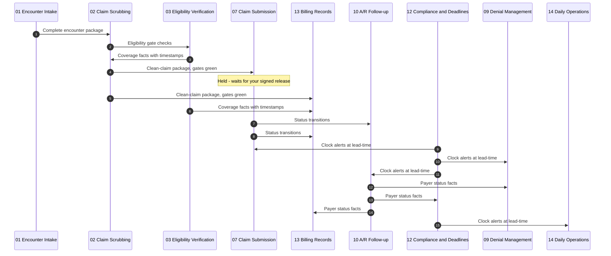

*One recorded run of `test_p06_ar_followup_chase`, numbered in order. Left out: each agent logging to the record and reporting what it is waiting on. The ratified steps: [playbooks/P06-ar-aging-followup](../playbooks/P06-ar-aging-followup/README.md).*
<!-- /diagram:run-p06 -->

*It starts when:* Aging threshold or `deadline.alert` surfaces an account at 10.

**Phase 1 - Payer side**

1. Agent 10: Chase payer status per cadence; record facts with rep references.
   - Wire: `payer.status` → 09, 12, 13
   - Proof it happened: stated dates recorded as stated-by-payer, never as posted

**Phase 2 - Patient side**

2. Agent 10: Run the published contact sequence via approved templates.
   - Wire: `patient.message.request` → 04
   - Proof it happened: sequence position recorded per contact; ceiling absolute
3. Agent 04: Route replies by content; hardship verbatim to human.
   - Wire: `patient.reply` → 10, 11
   - Proof it happened: hardship statements never absorbed into the sequence

*It can stop early:*
- Sequence exhausted unresolved: human queue with the complete contact history - the sequence ends in a decision.

## P07 - Patient Billing Cycle

<!-- diagram:run-p07 - drawn by tools/gen_diagrams.py; edit the generator, not here -->
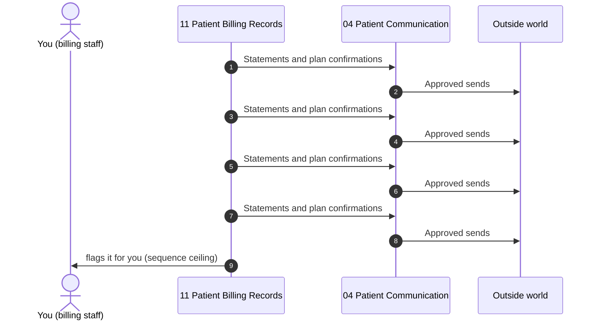

*One recorded run of `test_p07_patient_sequence_ceiling_never_auto_refers`, numbered in order. Left out: each agent logging to the record and reporting what it is waiting on. The ratified steps: [playbooks/P07-patient-billing-cycle](../playbooks/P07-patient-billing-cycle/README.md).*
<!-- /diagram:run-p07 -->

*It starts when:* `remit.posted` lands patient-responsibility amounts at 11, or the statement cycle date arrives.

**Phase 1 - Statements**

1. Agent 11: Generate statement records per the published cycle.
   - Wire: `billing.record` → 13
   - Proof it happened: statement record with posted-balance reference
2. Agent 04: Statement sends on approved templates.
   - Wire: `patient.message.send`
   - Proof it happened: sends logged verbatim

**Phase 2 - Plans**

3. Agent 11: Set up in-policy payment plans with the policy cited; exceptions route to human.
   - Wire: `billing.record` → 13
   - Proof it happened: plan terms + citation (or authority envelope_id) on record
4. Agent 10: Missed-plan-payment handling per the published sequence.
   - Wire: `patient.message.request` → 04
   - Proof it happened: sequence facts recorded; no improvised consequences

*It can stop early:*
- Balance changes mid-cycle: queued statements regenerate against the current record before send.

## P08 - Timely Filing Protection

<!-- diagram:run-p08 - drawn by tools/gen_diagrams.py; edit the generator, not here -->
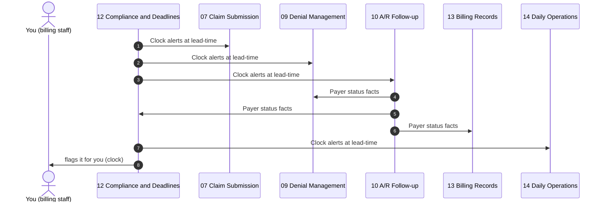

*One recorded run of `test_p08_timely_filing_lead_then_escalation`, numbered in order. Left out: each agent logging to the record and reporting what it is waiting on. The ratified steps: [playbooks/P08-timely-filing-protection](../playbooks/P08-timely-filing-protection/README.md).*
<!-- /diagram:run-p08 -->

*It starts when:* Continuous: clock instantiation on every claim path; alerts at ratified lead-times.

**Continuous - the clock engine**

1. Agent 12: Instantiate filing clocks per payer on every claim; disputed dates run from the earlier.
   - Wire: (clock set)
   - Proof it happened: every claim carries its window
2. Agent 12: Fire alerts at lead-times to the owners of the next action.
   - Wire: `deadline.alert` → 07, 09, 10, 14
   - Proof it happened: alerts logged with lead-time basis
3. Agent 07: At-risk claims surface for priority handling; gate conflicts escalate.
   - Wire: (priority handling)
   - Proof it happened: no clock ever overrides a gate
4. Agent 14: Clock reconciliation into the books: satisfied, at-risk, missed - misses quantified.
   - Wire: (book sections)
   - Proof it happened: misses named with owners, never buried

*It can stop early:*
- Rule-table gap for a payer: the clock runs on the most conservative known limit and the gap escalates for ratification.

## P09 - Morning Operations

<!-- diagram:run-p09 - drawn by tools/gen_diagrams.py; edit the generator, not here -->
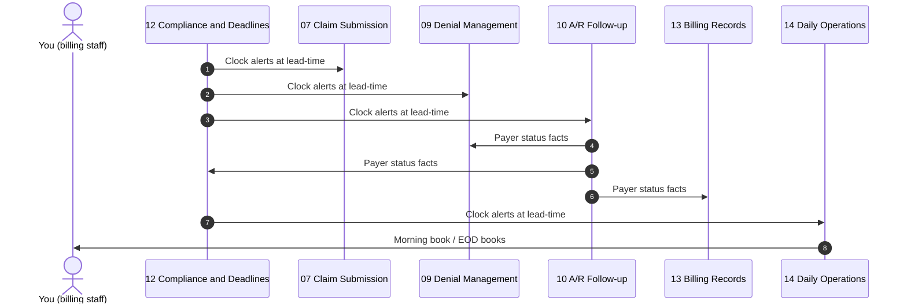

*One recorded run of `test_p09_p10_morning_report_carries_waits_and_clocks`, numbered in order. Left out: each agent logging to the record and reporting what it is waiting on. The ratified steps: [playbooks/P09-morning-operations](../playbooks/P09-morning-operations/README.md).*
<!-- /diagram:run-p09 -->

*It starts when:* Scheduled daily start (owner-configured time) or owner command.

**Assemble (parallel, all to human review)**

1. Agent 14: Pull overnight remit/denial activity and aging exceptions.
   - Wire: `record.request` → 13
   - Proof it happened: overnight + exceptions sections sourced
2. Agent 14: Today's clock alerts: filing, appeals, auth expirations.
   - Wire: (from 12's alert stream)
   - Proof it happened: clock section current with lead-times

**Present**

3. Agent 14: Deliver the morning book; unavailable sources marked absent.
   - Wire: `report.package` → human
   - Proof it happened: book delivered; the human directs

*It can stop early:*
- Record source down: section marked absent; the book still delivers on time.

## P10 - End-of-Day Books

<!-- diagram:run-p10 - drawn by tools/gen_diagrams.py; edit the generator, not here -->

*One recorded run of `test_p09_p10_morning_report_carries_waits_and_clocks`, numbered in order. Left out: each agent logging to the record and reporting what it is waiting on. The ratified steps: [playbooks/P10-end-of-day-books](../playbooks/P10-end-of-day-books/README.md).*
<!-- /diagram:run-p10 -->

*It starts when:* Scheduled day end (owner-configured time) or owner command.

**Assemble**

1. Agent 14: Pull the day's activity chronology: submissions, postings, denials, appeals, plans.
   - Wire: `record.request` → 13
   - Proof it happened: activity sections sourced with timestamps
2. Agent 14: Clock reconciliation: satisfied, at-risk, missed - misses quantified with owners.
   - Wire: (from 12's stream + records)
   - Proof it happened: reconciliation complete
3. Agent 14: Missed-item sweep against the morning book.
   - Wire: (sweep vs. P09 baseline)
   - Proof it happened: sweep complete; no silent reassignment

**Present**

4. Agent 14: Deliver the EOD books.
   - Wire: `report.package` → human
   - Proof it happened: books delivered; P10 completion event logged for tomorrow's P09

*It can stop early:*
- Morning baseline absent: the sweep names that first and proceeds on records alone.

## P11 - Eligibility Change Mid-Cycle

<!-- diagram:run-p11 - drawn by tools/gen_diagrams.py; edit the generator, not here -->
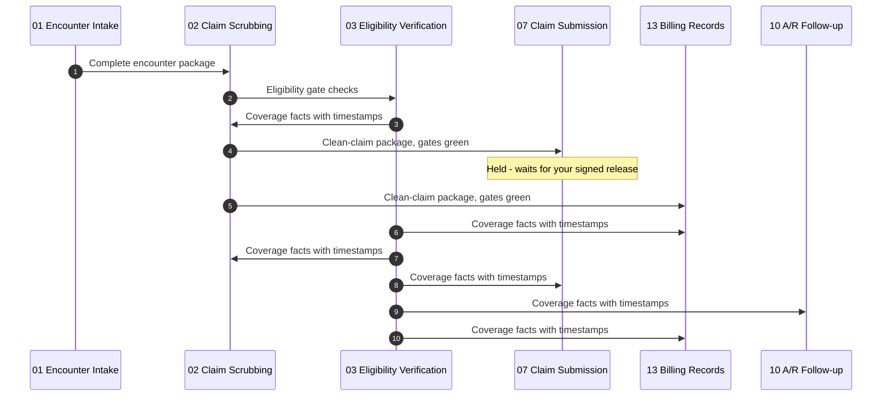

*One recorded run of `test_p11_eligibility_change_midcycle_holds_unsubmitted`, numbered in order. Left out: each agent logging to the record and reporting what it is waiting on. The ratified steps: [playbooks/P11-eligibility-change-midcycle](../playbooks/P11-eligibility-change-midcycle/README.md).*
<!-- /diagram:run-p11 -->

*It starts when:* `eligibility.result` at 03 (re-verify or payer notice) differing from the coverage facts a claim was gated on.

**Phase 1 - Blast radius**

1. Agent 03: Report the change with both fact sets and timestamps.
   - Wire: `eligibility.result` → 02, 07, 10, 13
   - Proof it happened: old and new coverage facts on record
2. Agent 13: Return every claim gated on the prior facts.
   - Wire: `record.response` → 07, 10
   - Proof it happened: affected-claim list with gate citations

**Phase 2 - Re-gate**

3. Agent 07: Hold unsubmitted affected claims at the gate.
   - Wire: (hold; `agent.status` → 14 while waiting)
   - Proof it happened: held claims named with reason
4. Agent 02: Re-scrub held claims against corrected coverage.
   - Wire: `scrub.result` → 07, 13
   - Proof it happened: fresh gate state per claim
5. Agent 10: Re-anchor in-flight follow-up to corrected facts.
   - Wire: `payer.status` → 12, 13
   - Proof it happened: follow-up record cites the change

*It can stop early:*
- Payer systems down for re-verify: affected claims hold; the outage is named (03's outage tuple governs).
- Change implies retroactive termination: human notified with the full record - retro-term disputes are human/payer conversations.

## P12 - Secondary Claim Cascade

<!-- diagram:run-p12 - drawn by tools/gen_diagrams.py; edit the generator, not here -->
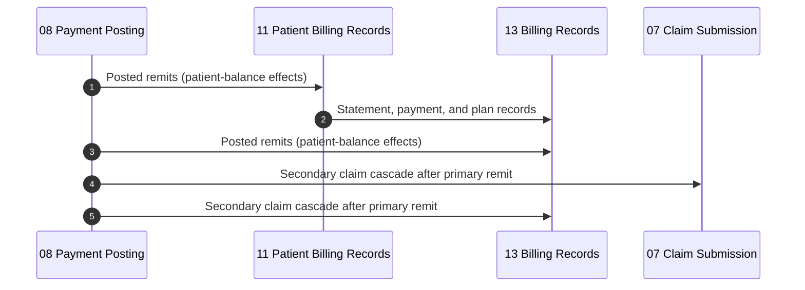

*One recorded run of `test_p12_secondary_cascade_fires_and_gates`, numbered in order. Left out: each agent logging to the record and reporting what it is waiting on. The ratified steps: [playbooks/P12-secondary-claim-cascade](../playbooks/P12-secondary-claim-cascade/README.md).*
<!-- /diagram:run-p12 -->

*It starts when:* `secondary.claim.ready` at 07: primary remit posted (08) with a secondary payer on file.

**Phase 1 - Assemble**

1. Agent 08: Package primary payment facts verbatim (paid, adjusted, patient responsibility).
   - Wire: `secondary.claim.ready` → 07, 13
   - Proof it happened: primary EOB facts attached verbatim
2. Agent 03: Confirm secondary coverage active on DOS.
   - Wire: `eligibility.result` → 07, 13
   - Proof it happened: secondary coverage facts with timestamps

**Phase 2 - Gate and submit**

3. Agent 02: Fresh scrub with COB edits.
   - Wire: `scrub.result` → 07, 13
   - Proof it happened: gate-green with edit-table version
4. Agent 07: Submit; both acceptance artifacts confirmed.
   - Wire: `claim.submit` → external; `claim.status` → 10, 13
   - Proof it happened: clearinghouse AND payer ack on record

*It can stop early:*
- Secondary coverage cannot be confirmed: claim holds; unknown blocks gates (identity rule).
- Timely-filing clock on the secondary at risk: P08 doctrine takes over - escalate at lead-time.

## P13 - Credit Balance & Refund Compliance

<!-- diagram:run-p13 - drawn by tools/gen_diagrams.py; edit the generator, not here -->
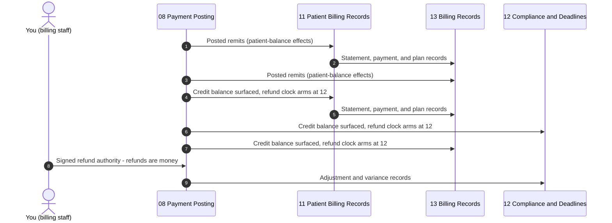

*One recorded run of `test_p13_credit_refund_signed_inside_clock`, numbered in order. Left out: each agent logging to the record and reporting what it is waiting on. The ratified steps: [playbooks/P13-credit-balance-refund](../playbooks/P13-credit-balance-refund/README.md).*
<!-- /diagram:run-p13 -->

*It starts when:* `credit.balance` at 12 (and 11, 13) from posting.

**Phase 1 - Clock and visibility**

1. Agent 12: Arm the refund clock per regulation (60-day rule where applicable); lead-time alerts set.
   - Wire: `deadline.alert` → 10, 14 (at lead-times)
   - Proof it happened: clock live with regulatory citation
2. Agent 11: Post the credit to the patient-facing ledger with refund status.
   - Wire: `billing.record` → 13
   - Proof it happened: credit visible on the account

**Phase 2 - Human decision and execution**

3. Agent 08: Package the credit: source remits, payments, computed amount, payee determination facts.
   - Wire: `reconciliation.exception` → human, 13
   - Proof it happened: package delivered inside lead-time
4. Agent 08: Execute the refund on signed authority only.
   - Wire: (await `refund.authority` ← human)
   - Proof it happened: signed envelope on the chain before any money moves
5. Agent 04: Notify the patient from posted facts once executed.
   - Wire: `patient.message.send` → external
   - Proof it happened: templated notice, posted-facts only

*It can stop early:*
- Payee ambiguous (patient vs payer vs unclaimed-property): human decision with both determinations packaged - the swarm never picks a payee.
- Signed authority not received at escalation threshold: certain-miss escalation fires; the miss is named in the books (P08 doctrine).

## P14 - Records Request Response

<!-- diagram:run-p14 - drawn by tools/gen_diagrams.py; edit the generator, not here -->
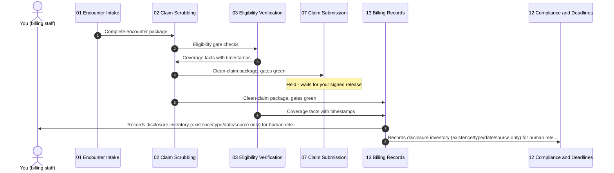

*One recorded run of `test_p14_records_request_sealed_inventory`, numbered in order. Left out: each agent logging to the record and reporting what it is waiting on. The ratified steps: [playbooks/P14-records-request-response](../playbooks/P14-records-request-response/README.md).*
<!-- /diagram:run-p14 -->

*It starts when:* External records request lands: payer audit via 10, patient access request via 04.

**Phase 1 - Clock and inventory**

1. Agent 12: Arm the response clock (regulatory default if none stated).
   - Wire: `deadline.alert` → 10, 14 (at lead-times)
   - Proof it happened: clock live
2. Agent 13: Assemble the disclosure inventory: existence, type, date, source per item - content sealed.
   - Wire: `records.disclosure.package` → human, 12
   - Proof it happened: inventory delivered inside lead-time
3. Agent 05: Flag any inventoried item in sealed clinical custody.
   - Wire: `doc.received` → 13 (custody references)
   - Proof it happened: custody status per item

**Phase 2 - Human release**

4. Agent 13: Record the human's release decision and what was disclosed.
   - Wire: `record.response` + `interaction.log`
   - Proof it happened: disclosure record: who, what, when, under whose approval
5. Agent 04/10: Transmit per the human's approved scope (patient lane via 04, payer lane via 10).
   - Wire: `patient.message.send` / `payer.status`
   - Proof it happened: transmission artifact on record

*It can stop early:*
- Request scope ambiguous or overbroad: clarification to human before any inventory work product leaves the swarm.
- Misdirected or wrong-patient material discovered during inventory: 05's sealed-misdirect protocol - human immediately, HIPAA incident logged.
