# Start Here - 60 Seconds

```mermaid
flowchart LR
    B(["You (billing staff)"])
    H{{"00 Dispatcher hub<br/>carries and logs every message"}}
    B -- "signed decisions and settings" --> H
    H -- "questions, holds, reports" --> B
    subgraph AG["The agents - each owns one job"]
        direction TB
        A01["01 Encounter Intake"]
        A02["02 Claim Scrubbing"]
        A03["03 Eligibility Verification"]
        A04["04 Patient Communication"]
        A05["05 Documentation Collection"]
        A06["06 Prior Authorization"]
        A07["07 Claim Submission"]
        A08["08 Payment Posting"]
        A09["09 Denial Management"]
        A10["10 A/R Follow-up"]
        A11["11 Patient Billing Records"]
        A12["12 Compliance and Deadlines"]
        A13["13 Billing Records"]
        A14["14 Daily Operations"]
    end
    H <--> AG
    X[/"Outside world"/]
    H <-- "only on open lanes; anyone but the party you serve waits for your release" --> X
    classDef you fill:#f2cc60,stroke:#9a6700,color:#1f2328
    classDef hub fill:#1f6feb,stroke:#1f6feb,color:#ffffff
    classDef out fill:#d0d7de,stroke:#57606a,color:#1f2328
    class B you
    class H hub
    class X out
```

<!-- diagram:docs-start-here-start-here - drawn by tools/gen_diagrams.py; edit the generator, not here -->


*Every arrow goes through the hub, and only on lanes in `identity/routes.json`. Each agent's own picture is in its folder (`../NN-*/README.md`); each playbook's in `playbooks/`.*
<!-- /diagram:docs-start-here-start-here -->

**What this is:** a 14-agent medical-billing swarm on a closed track. One
hub routes everything; only pre-approved (sender, intent, receiver) tuples
are legal; every action lands on a hash-chained, tamper-evident audit log.

**What it does:** charge capture, eligibility facts, scrubbing, prior-auth
packaging, submission (both acks or it didn't happen), posting with
contract citations, two-lane denial triage, A/R follow-up, the published
patient sequence, filing clocks, credit-balance/refund compliance, records
requests, and the daily books.

**What it never does:** code, appeal, diagnose, promise coverage, read
clinical content, move unsigned money, pressure a patient past the
published sequence, or let a denial or a clock die quietly. Each of those
is enforced in code and proven by a test.

**See it work (2 minutes):**
```
git clone https://github.com/QuietFireAI/medbilling-agents.git
cd medbilling-agents && pip install -r requirements.txt
python3 tools/run_demo.py        # one patient, six acts, real hub
python -m pytest tests_medbilling/   # every playbook, every gate
```

**Read next:** WHAT_SUCCESS_MEANS.md (what each playbook delivers and
what the human still owns) -> PLAY-BY-PLAY.md (every step narrated) ->
JOB_DESCRIPTIONS.md (one entry per agent) -> OPERATOR_TESTING_MANUAL.md
(the filmable test script) -> TUNING_MANUAL.md (every knob and every
honest placeholder).
