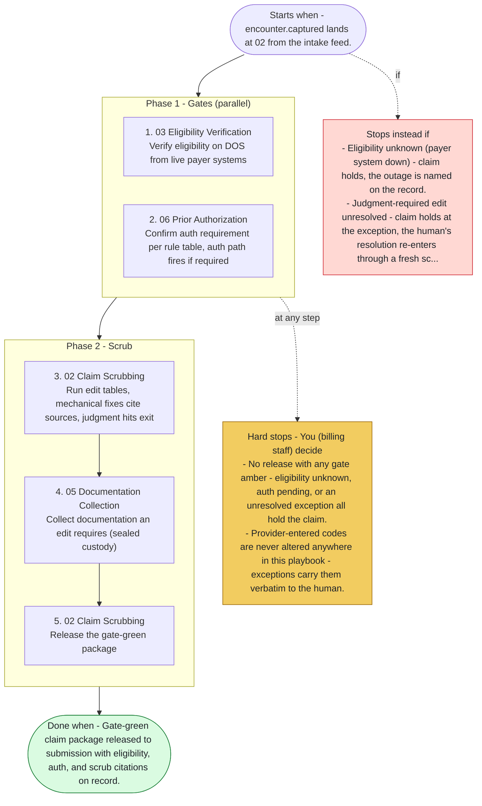

# Playbook P01 - Charge to Clean Claim

Swarm deployment - provider-documented encounter to gate-green claim package. Agents 01, 02, 03, 06, 05, 13. Coding judgment exits to the certified human at every crossing - the swarm checks rules, it never codes.

**Priority class:** 2 ([what the classes mean](../README.md))

## The steps

Read top to bottom. Boxes inside a phase marked parallel run side by side; the others run in order. The yellow box lists where the playbook stops for you; the red box, when it does not start or stops instead.

- [SKILL.md](SKILL.md) - the full playbook: preconditions, intents, proof of done for each step

*Generated by `tools/gen_diagrams.py` from the playbook data; edit the data or the generator, not this file.*
