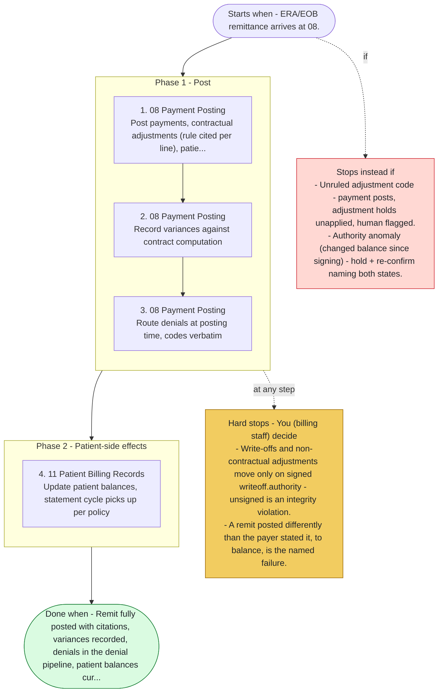

# Playbook P04 - Payment Posting & Reconciliation

Swarm deployment - remittance to posted, reconciled, variance-visible financial records. Agents 08, 11, 12, 09, 13. Payer facts post verbatim, contract rules cite themselves, everything else needs signed authority.

**Priority class:** 2 ([what the classes mean](../README.md))

## The steps

Read top to bottom. Boxes inside a phase marked parallel run side by side; the others run in order. The yellow box lists where the playbook stops for you; the red box, when it does not start or stops instead.

- [SKILL.md](SKILL.md) - the full playbook: preconditions, intents, proof of done for each step

*Generated by `tools/gen_diagrams.py` from the playbook data; edit the data or the generator, not this file.*
