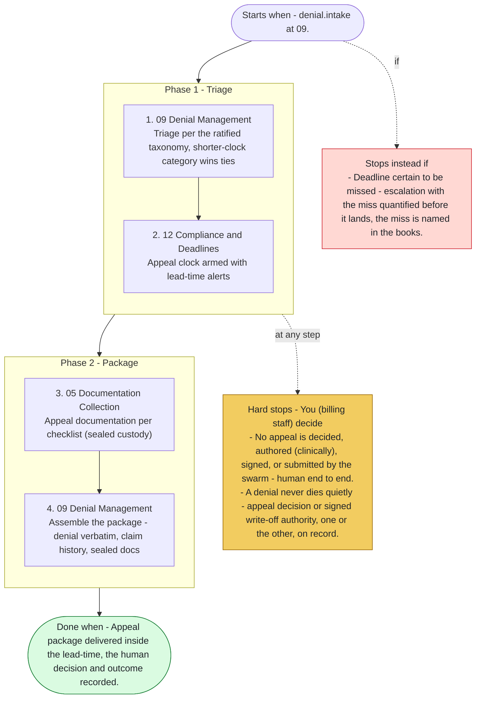

# Playbook P05 - Denial & Appeal Cycle

Swarm deployment - posted denial to human-decided appeal with a complete package inside the deadline. Agents 09, 05, 12, 10, 13. The appeal decision, clinical argument, and signature are human - the swarm builds the package and watches the clock.

**Priority class:** 1 ([what the classes mean](../README.md))

## The steps

Read top to bottom. Boxes inside a phase marked parallel run side by side; the others run in order. The yellow box lists where the playbook stops for you; the red box, when it does not start or stops instead.

- [SKILL.md](SKILL.md) - the full playbook: preconditions, intents, proof of done for each step

*Generated by `tools/gen_diagrams.py` from the playbook data; edit the data or the generator, not this file.*
