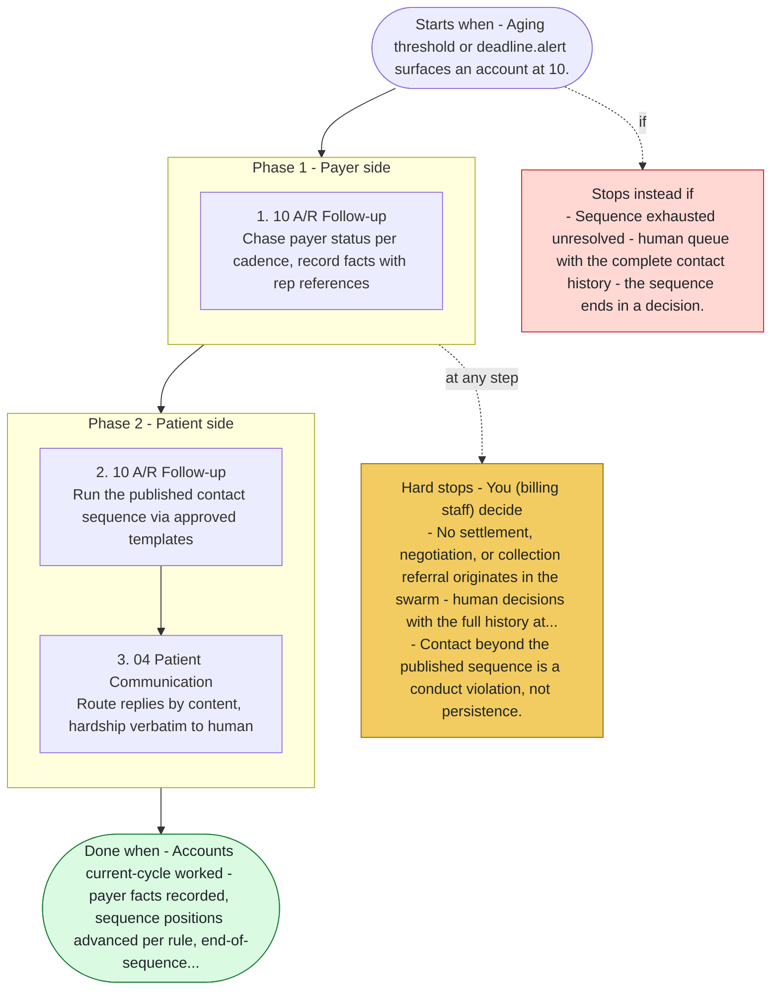

# Playbook P06 - A/R Aging Follow-up

Swarm deployment - aging accounts worked on cadence with facts, not pressure. Agents 10, 04, 12, 13. Payer chases produce status facts, patient contact runs the published sequence to its end - which is a human decision, never an invented next step.

**Priority class:** 3 ([what the classes mean](../README.md))

## The steps

Read top to bottom. Boxes inside a phase marked parallel run side by side; the others run in order. The yellow box lists where the playbook stops for you; the red box, when it does not start or stops instead.

- [SKILL.md](SKILL.md) - the full playbook: preconditions, intents, proof of done for each step

*Generated by `tools/gen_diagrams.py` from the playbook data; edit the data or the generator, not this file.*
