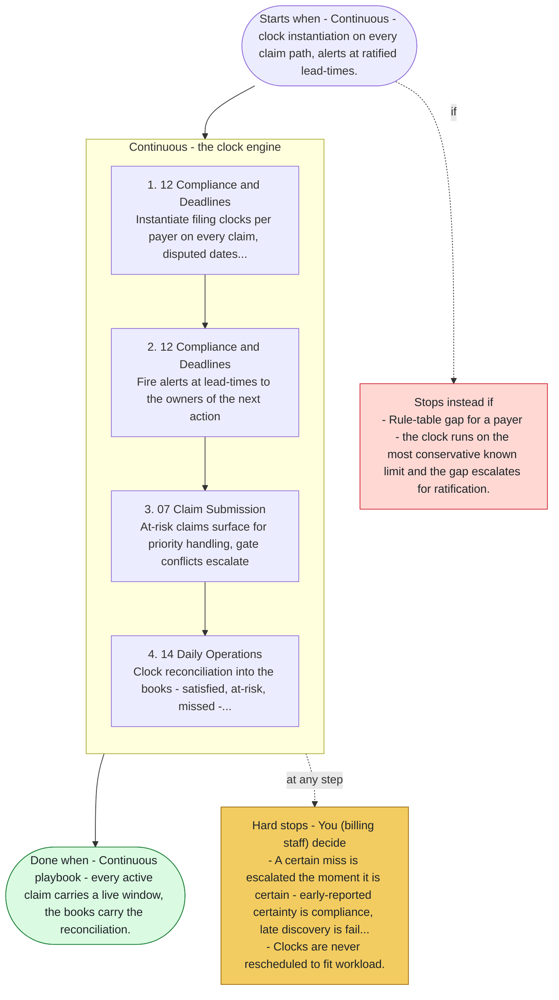

# Playbook P08 - Timely Filing Protection

Swarm deployment - the filing-clock engine end to end - every claim's window tracked, at-risk claims surfaced at lead-time, certain misses escalated before they land. Agents 12, 07, 10, 14, 13. Clocks are facts, conservatism is ratified.

**Priority class:** 1 ([what the classes mean](../README.md))

## The steps

Read top to bottom. Boxes inside a phase marked parallel run side by side; the others run in order. The yellow box lists where the playbook stops for you; the red box, when it does not start or stops instead.

- [SKILL.md](SKILL.md) - the full playbook: preconditions, intents, proof of done for each step

*Generated by `tools/gen_diagrams.py` from the playbook data; edit the data or the generator, not this file.*
