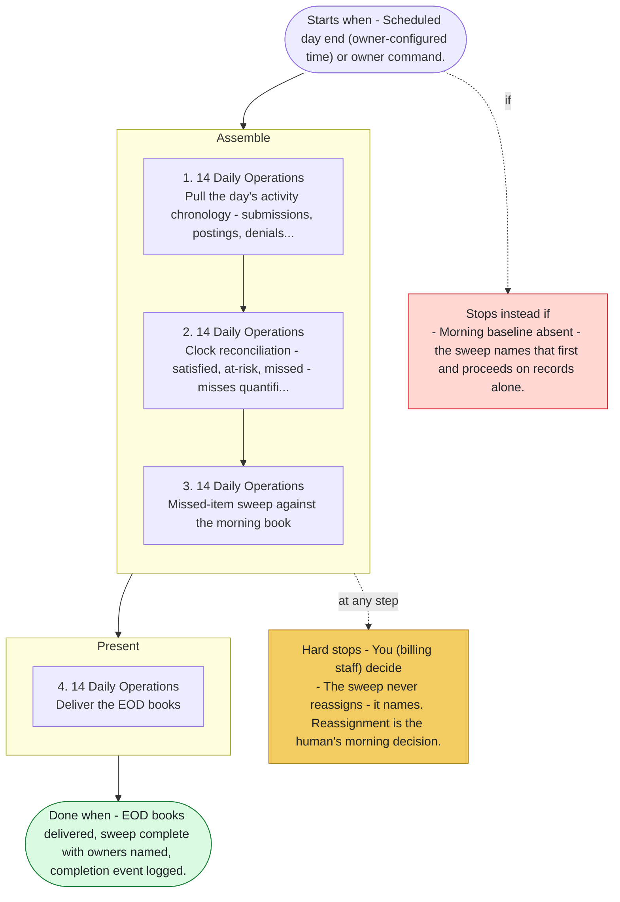

# Playbook P10 - End-of-Day Books

Swarm deployment - the closing books. Claims out, remits posted, denials triaged, appeals packaged, clock reconciliation, the missed-item sweep. Agents 14, 13, 12. Gaps named, a clean-looking book with hidden gaps is the named failure.

**Priority class:** 2 ([what the classes mean](../README.md))

## The steps

Read top to bottom. Boxes inside a phase marked parallel run side by side; the others run in order. The yellow box lists where the playbook stops for you; the red box, when it does not start or stops instead.

- [SKILL.md](SKILL.md) - the full playbook: preconditions, intents, proof of done for each step

*Generated by `tools/gen_diagrams.py` from the playbook data; edit the data or the generator, not this file.*
