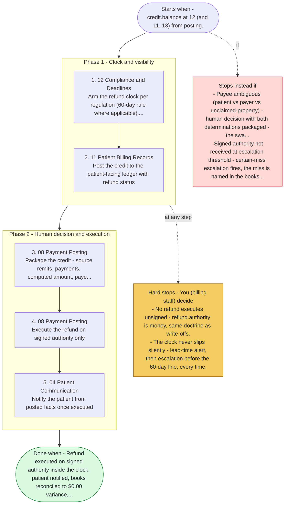

# Playbook P13 - Credit Balance & Refund Compliance

Swarm deployment - surfaced credit balance to signed, executed refund inside the regulatory clock. Agents 08, 12, 11, 04, 13. Class 1 - the federal 60-day overpayment rule is a filing clock with penalties.

**Priority class:** 1 ([what the classes mean](../README.md))

## The steps

Read top to bottom. Boxes inside a phase marked parallel run side by side; the others run in order. The yellow box lists where the playbook stops for you; the red box, when it does not start or stops instead.

- [SKILL.md](SKILL.md) - the full playbook: preconditions, intents, proof of done for each step

*Generated by `tools/gen_diagrams.py` from the playbook data; edit the data or the generator, not this file.*
