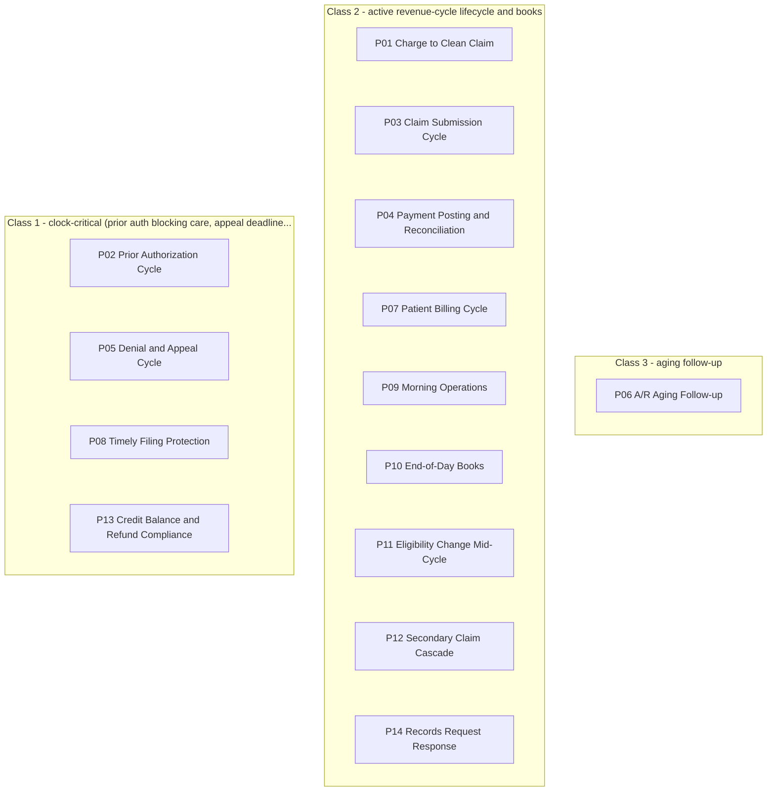

# Playbooks

Each playbook is a fixed route through the agents for one kind of work. When two playbooks need the same agent at once, the lower class number goes first; the other waits on a siding, nothing is dropped (`identity/priority.json`).

*Left to right: class 1 goes first when two playbooks need the same agent.*

- [P01 Charge to Clean Claim](P01-charge-to-clean-claim/README.md)
- [P02 Prior Authorization Cycle](P02-prior-auth-cycle/README.md)
- [P03 Claim Submission Cycle](P03-claim-submission-cycle/README.md)
- [P04 Payment Posting & Reconciliation](P04-payment-posting-reconciliation/README.md)
- [P05 Denial & Appeal Cycle](P05-denial-appeal-cycle/README.md)
- [P06 A/R Aging Follow-up](P06-ar-aging-followup/README.md)
- [P07 Patient Billing Cycle](P07-patient-billing-cycle/README.md)
- [P08 Timely Filing Protection](P08-timely-filing-protection/README.md)
- [P09 Morning Operations](P09-morning-operations/README.md)
- [P10 End-of-Day Books](P10-end-of-day-books/README.md)
- [P11 Eligibility Change Mid-Cycle](P11-eligibility-change-midcycle/README.md)
- [P12 Secondary Claim Cascade](P12-secondary-claim-cascade/README.md)
- [P13 Credit Balance & Refund Compliance](P13-credit-balance-refund/README.md)
- [P14 Records Request Response](P14-records-request-response/README.md)

*Generated by `tools/gen_diagrams.py`; edit the data or the generator, not this file.*
